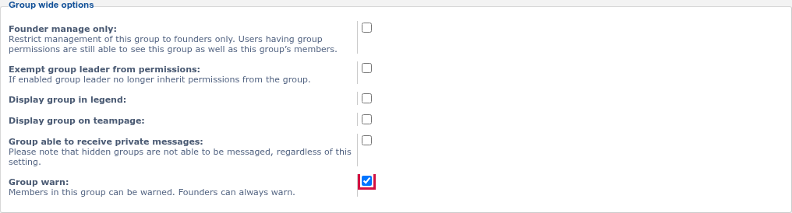

# Group Warn screenshots

## Group warn setting

The **Group warn** setting on a group's page under ACP → Users and Groups → Manage groups. Members can be warned only when every group they belong to has it ticked. Here it is ticked for Registered users.

