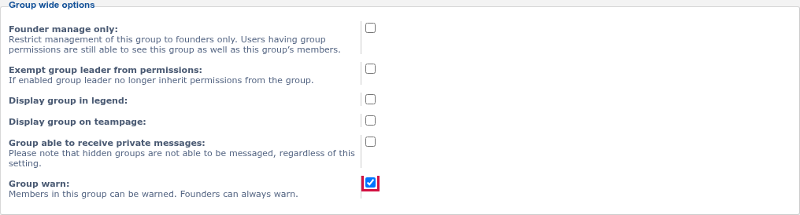

# Group Warn: update of 11/10/2026

Screenshot for the 11/10/2026 update of the 1.0.0-dev build.

## Group warn setting

The **Group warn** setting under ACP → Users and Groups → Manage groups, ticked for Registered users. Members can be warned only when every group they belong to has it ticked.

